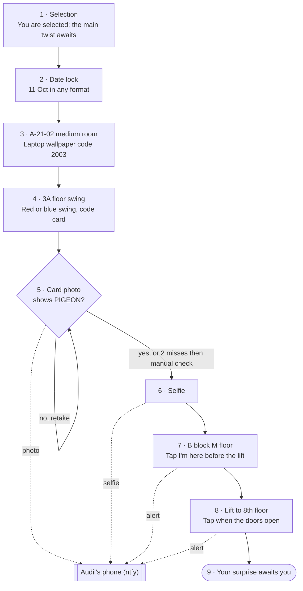

# Operation 11·10

Muskan's birthday mission: a phone-first escape-room route from the link at 12am to the surprise on B block's 8th floor.

**Live site:** https://huzaib123.github.io/DAY/ · **Handler desk:** https://huzaib123.github.io/DAY/#handler (PIN in `js/config.js`)

## Flowmap



## Change the words or codes

Everything Muskan reads, every code, the ntfy topic and the handler PIN live in [`js/config.js`](js/config.js). Edit it on GitHub (pencil icon, commit) and the site updates within a minute or two.

## How it stays working in lifts

- Progress and every unlocked code are saved on her phone (`localStorage`), so a reload lands on the same screen.
- A service worker (`sw.js`) caches the site on first open, so it reloads with no signal.
- Photos and check-ins queue in IndexedDB (`js/outbox.js`) and send when signal returns.
- A notice on every screen tells her this, and the code notebook lists everything saved.

## Photos and alerts

Sent to the free [ntfy](https://ntfy.sh) service. Install the ntfy app, tap **+**, and subscribe to the topic in `js/config.js`. The handler desk shows the same feed. ntfy.sh topics are readable by anyone who knows the name, and attachments expire after a few hours, so save the photos you want.

The PIGEON check runs on her phone with [Tesseract.js](https://github.com/naptha/tesseract.js) (Apache-2.0), hosted in `vendor/tesseract`.

## Test

```
npm install
npx playwright install chromium
npm run serve        # in one terminal
npm test             # in another
```

The test walks the whole route on an iPhone-sized screen with ntfy mocked, including an offline reload and an alert held until signal returns.
